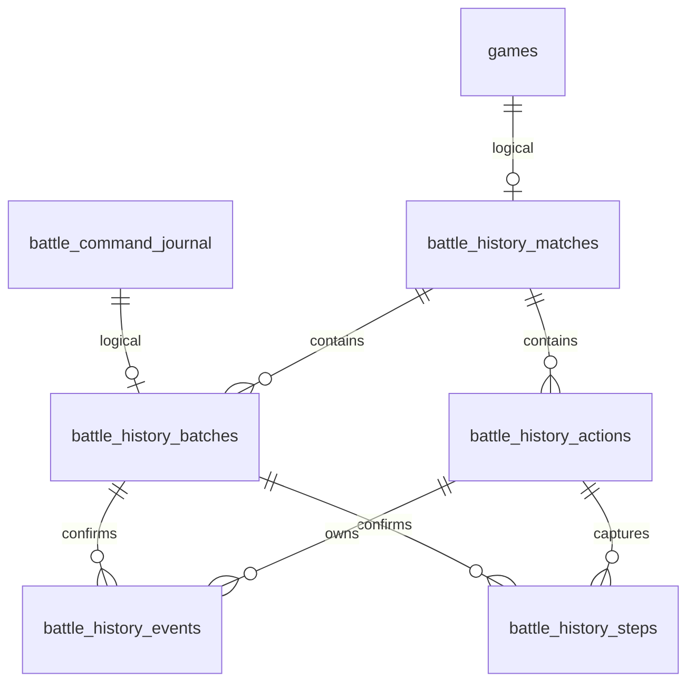

# Battle History — Stage 4A persistence contract

Статус Stage 4A.1: независимая инфраструктура без SQL-триггеров, по решению Project Lead. Пять production-таблиц уже созданы; повторная полная миграция не нужна. Не включена в игровые команды. Основа — `2755c79a6f20c98725b8d9709188884f2c902ce2`, включая R1–R3 из `9e5e57e6fd6db044323cd413a1704fe29ced0c5e`. Production HEAD и DDL неизвестны. Решения о границах остаются в [Action Lifecycle specification](battle-replay-action-lifecycle-spec.md).

## Понятия и пять таблиц

Command идентифицируется существующим journal.id; исходный ключ — game_id/player_key/command_id. Root Action связывает причинную цепочку, живёт через несколько команд. Child Action нужен только самостоятельному вызванному действию. Event описывает факт. Replay Step описывает согласованную границу; snapshot — самостоятельные данные поля на этой границе. Ни SQL, ни этот компонент не выбирают границы, не управляют продолжениями и не исполняют Engine.

| Таблица | Поля и назначение | Ограничения / индексы |
|---|---|---|
| battle_history_matches | game_id; recording_status; completeness; event_version/snapshot_version; has_initial/has_final; last_event_seq/last_step_seq; created_at/updated_at | PK game_id; версии 1 в реализации, положительные smallint в SQL; статусы CHECK |
| battle_history_batches | game_id, journal_id, player_key, command_id, persistence_version, batch_hash; first/last event_seq и step_seq; created_at | PK(game_id,journal_id), UNIQUE journal_id, UNIQUE(game_id,player_key,command_id), INDEX(game_id,command_id) |
| battle_history_actions | game_id, action_id, root_id, parent_id; action_type, initiator, lifecycle; started/ended_event_seq; completion_json | PK(game_id,action_id), INDEX(game_id,root_id); lifecycle CHECK; completion JSON CHECK |
| battle_history_events | game_id,event_seq; journal_id,command_order; action_id,event_type,schema_version,cause_event_seq; payload_json,public_json,host_json,player_json; occurred_at | PK(game_id,event_seq); UNIQUE(game_id,journal_id,command_order); INDEX(game_id,action_id,event_seq); JSON CHECK |
| battle_history_steps | game_id,step_seq; journal_id,capture_order; boundary_key,step_type,action_id,last_event_seq; persistence_version,schema_version; state_json и три проекции; state_hash; is_initial/is_final; created_at | PK(game_id,step_seq); UNIQUE boundary на матч, capture_order на command; generated guards дают максимум один initial/final; JSON CHECK; INSERT-only контракт приложения; проверка checksum при чтении |

FK только внутри новых таблиц: match→batch/actions, batch→events/steps, action→events/steps; без CASCADE. root/parent и start/end/cause проверяются компонентом в той же транзакции: cyclic FKs при создании action/event не нужны. Lifecycle start/end должны ссылаться на событие своего action. Parent должен существовать; интервал child входит в интервал parent. Parent может быть уже записан terminal в том же batch, если его end включает child; root — существующий корень. Завершённые lifecycle не открываются повторно. Завершение root при существующем open child пока не запрещено SQL: будущий Recorder должен согласовать scopes; завершение всего матча требует явного закрытия/прерывания всех open actions.

game_id — signed BIGINT новых таблиц, вмещает signed/unsigned INT без предположения типа games.ind. PHP API ограничен положительными PHP int; sequences также ограничены PHP_INT_MAX. journal_id соответствует unsigned BIGINT из текущего CommandJournalRepository. Внешних FKs к games/journal нет: см. обязательный production preflight. Новые ASCII identifiers имеют binary collation. Existing journal может сравнивать command_id без учёта регистра — его найденный journal.id и сохранённые player_key/command_id всегда авторитетны; компонент не регистрирует команды независимо и не создаёт вторую identity.

## Метаданные и полнота

| recording_status | completeness | Смысл |
|---|---|---|
| отсутствует запись / disabled | none | Регистрация не включена; отсутствие истории не выдавать за полный реплей |
| recording | complete | Заявлена непрерывная регистрация с начала; перед показом проверять has_initial |
| recording | incomplete | Частичная история, пропущенный префикс/разрыв |
| completed | complete | Подтверждён final, есть initial, история заявлена полной |
| completed | incomplete | Подтверждён final, но история неполна |

initialize явно вызывается отдельно, в транзакции под games lock. По умолчанию не вызывается нигде. Включение для новых реальных матчей — следующий этап после согласования. Для старых матчей можно объявить incomplete, но не импортировать GameLog как replay. Нет автоматического backfill, purge или переключения статуса. Если завершение не имеет initial, компонент принудительно помечает incomplete. Заведомое объединение нескольких допустимых Replay Steps не означает потерю событий и само по себе не меняет completeness. Отсутствующий capture на техническом ACK допустим; отсутствие обязательной истории — ошибка всей транзакции.

## Входной batch

HistoryBatch сериализует массивы при создании, поэтому изменения исходных PHP-массивов после capture не меняют сохранённый DTO. Это не Engine adapter. Порядок массивов значим; hash SHA-256 — идентификатор точного batch, не универсальная канонизация JSON.

* actions: новые `{id,root,parent,type,initiator,status,start,end,completion}` либо переход существующего `{id,status,end,completion}`. start/end — 1-based индексы событий текущего batch. Новое open имеет start; существующее open может перейти только в settled/cancelled/interrupted. Pending/очереди не копируются.
* events: `{action,type,version:1,payload,public,host,player,at,cause?,cause_order?}`. Проекции обязательны, но null означает скрыто. at — UTC `YYYY-MM-DD HH:MM:SS.uuuuuu`; порядок задаётся не временем. cause — абсолютный предыдущий seq этого матча; cause_order — предыдущий 1-based индекс текущего batch. Передавать один вариант, cause_order имеет приоритет. Event type задаёт семантику payload; Stage 4A проверяет общий envelope и версию, не вводит реальные типы атак.
* captures: `{action,boundary,type,through,initial,final,state,public,host,player}`. through — число уже включённых событий текущего batch (0 допустим для продолжения существующего action). Абсолютный watermark = предыдущий last_event_seq + through. Порядок captures не убывает по watermark, но может совпадать. boundary — стабильный game-local ключ семантической границы (до 128 ASCII), переживающий retry и новую HTTP-команду. Генерация action/boundary IDs принадлежит будущему Recorder, не timestamp и не случайная новая identity при каждом retry.
* completeMatch=true требует game_over после CAS, final capture последним, finished=true во всех его DTO, отсутствие open actions. Final не выводится по одному winner или имени команды.

Events/steps append-only через API. Для snapshots нет UPDATE, DELETE, REPLACE или ON DUPLICATE KEY UPDATE; duplicate INSERT вызывает ошибку и полный rollback caller transaction. SQL-триггеры и привилегия TRIGGER больше не требуются. При наличии UPDATE/DELETE у SQL-пользователя приложение не может обеспечить физическую неизменяемость от внешних операций. Unique command/boundary/capture constraints остаются защитой от дублей. SQL DDL не выполняется из constructor.

Stage 4A.1 state_hash: SHA-256 от UTF-8 JSON envelope с полями в точном порядке: format="capture-sha256-v1", schema_version=(int), state_json, public_json, host_json, player_json. Последние четыре значения — **строки окончательно сериализованных и сохранённых JSON**, а не повторно закодированные DTO. Envelope кодируется JSON_UNESCAPED_UNICODE | JSON_UNESCAPED_SLASHES | JSON_THROW_ON_ERROR. Один checksum покрывает независимо сохранённые полное состояние и три проекции одного capture; разные captures имеют собственные checksum. Колонки и snapshot schema_version=1 остаются прежними.

steps проверяет hash_equals для каждого кадра до возврата результата, включая все проекции. Полные bytes и hash используются только внутри слоя хранения и удаляются из participant результата. completedServerHistory также проверяет все snapshots до возврата полной истории. При mismatch — UnexpectedValueException без повреждённого кадра, частичного результата или секретного payload в тексте ошибки. Reader не обновляет данные/хеши и не делает fallback к непроверенной проекции.

Прежний Stage 4A hash только state_json не подтверждает целостность проекций; Stage 4A.1 не принимает его автоматически и не пересчитывает при чтении. Регистрация истории ещё не включалась; возможные неожиданно существующие записи нужно выявить read-only counts и отдельно расследовать. Старые proof-файлы остаются историческими. Нет схемной миграции данных или API исправления кадров. SHA-256 выявляет случайное изменение bytes, но не предотвращает одновременную подмену содержимого и checksum SQL-пользователем с UPDATE, не защищает от внешнего DELETE и не является подписью/защитой от администратора БД. Метаданные вне envelope (identity/order/action) защищены контрактом/constraints, не криптографически.

## ReplayState v1

Самостоятельный display DTO, без `games.json`, pending, strike queues, props/flags, timer tokens, command IDs или журналов. Класс ReplayState не зависит от GameState/Engine. Exact whitelist отвергает лишние поля на всех структурных уровнях.

| Поля | Контракт |
|---|---|
| version, ruleset | version=1; стабильная версия правил/контента |
| participants | host/player, только label; авторизация и user IDs остаются вне DTO |
| turn, active | неотрицательный номер; host/player/null |
| finished, winner | bool; host/player/draw/null; winner до finished запрещён |
| cards | список уникальных строковых instance_id, стабильных для всего матча |
| card | definition,owner,zone,order,row,col,slot; hp/hp_max,move/move_max,armor/armor_max,strike(weak/medium/strong),coins; closed,revealed; statuses,markers,effects |
| catalog | definition→{revision,name,image,description,type,element,classes,price}, замороженные display references/текст |
| markers и card statuses/markers/effects | списки `{code,label,value}`; value scalar/null, без произвольных внутренних state объектов |

Неизвестные скрытые числовые характеристики и definition/strike могут быть null; неизвестную карту можно опустить. Producer обязан отдельно построить безопасный catalog для каждой проекции, не оставлять в нём секретное имя/текст скрытой карты. Только producer знает семантику секрета: schema validator не доказывает отсутствие утечки в произвольной строке. Ни reader, ни current revealed ничего не раскрывают задним числом. Позднее раскрытие — новое event и новый DTO; старый остаётся прежним.

Полная server payload и точные public/host/player проекции хранятся одновременно. Нет fallback от player_json к payload_json, даже если projection=null; null событие пропускается. Если нужен общий текст всем, producer явно повторяет его в нужных проекциях. Нельзя отдавать raw SELECT * events/steps через будущий endpoint. Методы events/steps принимают только public/host/player, для snapshots внутренне читают и проверяют checksum всех сохранённых проекций, затем возвращают только выбранную projection и безопасные метаданные; caller обязан аутентифицировать участника и определить view. Эти API — внутренние компоненты, не endpoints. completedServerHistory открывается только вне write transaction при committed final journal, persisted game_over, completed metadata и final capture; completeness остаётся отдельным признаком. Право пользователя читать завершённый матч также проверяет будущий endpoint.

Совместимость: сохранять snapshot/event schema_version и ruleset отдельно. v1-reader не должен читать неизвестные версии как v1; текущий validator отвергает v2. Будущий reader должен выбирать decoder соответствующей версии, с read-only upcast в памяти при необходимости; старые snapshots не переписывать. Catalog содержит frozen имена/описания/revision, характеристики уже в snapshot; картинки должны иметь устойчивые versioned/content-hash пути с политикой хранения assets. Текущий компонент не копирует assets и не гарантирует их внешнюю сохранность. Недоступный asset в будущем — placeholder, не подмена текущими свойствами карты. Повторное исполнение Engine исключено.

## Транзакция и будущая точка интеграции

Исследован текущий GameRepository.commitJournalCommand: begin → journal.requireProcessingForCommit (FOR UPDATE) → optional locked find/apply → save CAS games → journal.markCommitted → commit. Регистрация processing выполняется раньше, вне этой транзакции. GameRepository.save сам транзакции не открывает. create/setPlaymat и другие небоевые сохранения не следует автоматически превращать в зарегистрированные действия. AutomaticTurnEnd/AutomaticMatchPause/InformationalAutoAck и www/index.php используют executeLockedCommand; не все HTTP-запросы являются Replay Steps. Db.commit бросает TransactionCommitUnknownException с уже сброшенным inTransaction. Конструкторы старых repositories умеют проверять/создавать схему, поэтому их нужно завершить ДО begin; новый компонент DDL не делает.

Будущий минимальный патч (архитектурный контракт, не внедрён): добавить опциональный уже замороженный HistoryBatch/collector result в существующую commitJournalCommand; после успешного save($working) и проверки afterVersion, **непосредственно до markCommitted**, вызвать `$history->append($gameId,$journalId,$afterVersion,$batch)` на том же Db. При отказе apply не вызывать append. Для captures внутри apply будущий collector фиксирует копии в момент выполнения; он не читает финальное состояние несколько раз вместо ранних captures. Не делать дополнительный commit и не менять порядок блокировок. Передавать отдельный immutable batch, а не callback, который снова исполняет бой.

append проверяет processing journal, принадлежность game и expected_version+1; повторно берёт уже принадлежащие вызывающему journal/game locks и затем metadata lock. Metadata row сериализует game-local allocation. Номера резервируются и подтверждаются в той же транзакции: rollback возвращает counters вместе с rows. Несколько steps имеют одинаковую afterVersion games, но разные step_seq/capture_order/boundary, через один COMMIT. Глобальный auto_increment не используется ни для event, ни для step порядка. Capture order 1-based на command, event order независимо 1-based. event_seq и step_seq не обязаны совпадать. Нет обязательного capture на ACK/pending.

Caller владеет всей транзакцией. После любой ошибки append он ОБЯЗАН откатить всё: games, action changes, batch, events, steps, counters и committed transition. Нельзя поймать ошибку append и затем commit сохранить только games. Отдельно зарегистрированный processing остаётся и служит операционному recovery. Компонент не заменяет существующую обработку rejected/conflict/failed. Только соблюдение этого контракта будущим caller даёт end-to-end гарантию; synthetic coordinator уже проверен, production integration не выполнена.

Retry: после подтверждённого committed исхода journal read + committedBatch(game,journalId) возвращают прежние диапазоны/hash, events/steps читаются в seq порядке. Не вызывать append повторно и не запускать Engine. Hash конфликт при восстановлении входного batch — расследовать, не перезаписать. Тот же journal ID защищён UNIQUE, как и command/boundary. Новая command identity с прежней границей — ошибка и rollback, не новый кадр.

Unknown COMMIT: уничтожить подозрительное соединение и открыть новое; сначала прочитать journal identity/terminal outcome и committedBatch. committed + batch → принять старый outcome; committed без обязательного batch для history-enabled команды → нарушение инварианта, не дорисовывать историю из текущего games.json. processing + отсутствие batch не доказывает rollback: транзакция могла ещё выполняться; применять прежний recovery/locking protocol, дождаться исхода. Не помечать failed и не повторять apply по одному таймауту. Unknown rollback также требует reconciliation на свежем соединении. Только after acknowledged rollback безопасно повторять известную неизменную команду по штатным правилам. Deadlock/lock-timeout не частичный успех: полный rollback; retry с прежней identity и свежими locks. Не менять existing journal lock order и не выполнять DDL в этой транзакции.

## Гидра

Обязательные отдельные steps `combat(closed=false)` → `series_end(closed=true)` → `turn_end(closed=true)` допускаются в разных командах либо несколько captures одной команды/SQL-version. End — самостоятельное подтверждённое действие, не новое сражение и не child combat wrapper. Предыдущий кадр остаётся неизменным. Естественный конец — `combat(closed=true)` без дополнительного End. Повтор/отклонённый/no-op End не создаёт новую границу; это обязанность будущего Recorder по фактическому outcome, а не имени команды. SQL stable boundary/command uniqueness страхуют дублирование, но не распознают семантический no-op с заново придуманными IDs.

## Границы Stage 4A

Ни один production call site не ссылается на новый namespace. Нет Recorder, hooks, реальных events, endpoint/UI, migrations GameLog, изменения карт/Гидры/pending. Старое storage/диагностика/Command Journal неизменны. Миграция — только ручная по [инструкции Project Lead](battle-history-production-sql.md). Нет утверждения о проверенной production совместимости. Следующий этап требует отдельного согласования интеграции, secure projection producer и lifecycle IDs.
