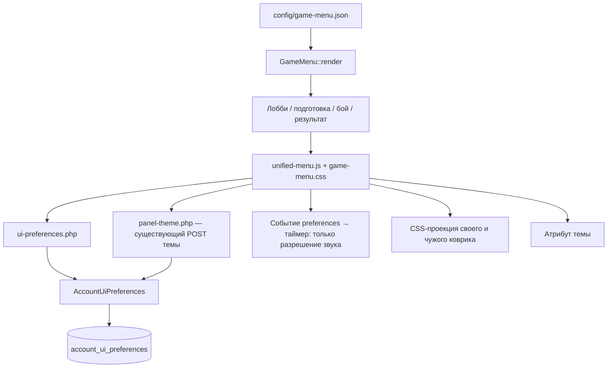

# Единое меню и предпочтения аккаунта

Реализованы игровые контексты `lobby`, `preparation`, `battle`, `finished` (все этапы подготовки обслуживает один контекст). Дизайн лобби, карточки и sticky-область сохранены. Страницы входа/регистрации/профиля остаются существующими целевыми маршрутами аккаунта.

## Общие компоненты

- `config/game-menu.json`: группы, типы, подписи, allow/deny, условия показа и нижнее положение аккаунта. Никакого исполняемого кода или серверных полномочий в JSON.
- `src/View/Ui/GameMenu.php`: единственная разметка меню и аккаунта. Существующая форма Debug подготовки сохранена здесь, отдельно от боевой операции.
- `www/assets/css/game-menu.css`: единая панель, кнопка, плашка аккаунта, панели выбора и анимация иконки с прежними боевыми длительностями 160/120 мс; reduced-motion отключает переходы.
- `www/assets/js/unified-menu.js`: открытие/закрытие, клавиатура, загрузка и сохранение настроек, единые панели выбора. Меню и панели выбора вынесены в body, чтобы контейнеры игры не обрезали их.
- `www/ui-preferences.php`: аккаунтная загрузка/сохранение. При `?game=` сначала выполняется прежний GameAccess::resolve; от соперника возвращаются только коврик и его ревизия. Передавать чужой account_id нельзя.
- `src/Auth/AccountUiPreferences.php`: то же существующее серверное хранилище, расширенное двумя предпочтениями и ревизией.
- `www/assets/js/battle-debug.js`: только адаптер существующего боевого Debug к общему меню. Это не вторая реализация меню.

Debug подготовки показывается в settings при прежнем DebugAccess; форма, команда, CSRF и prepare_version сохранены. Боевой Debug берёт доступность из существующей серверной проекции и текущего окна отладки. В лобби и на завершённом экране Debug отсутствует.

## Удалённые дубли

Удалены `battle-menu.js`, `game-menu.js`, `battle-playmats.js`, `battle-panel-themes.js`, отдельная разметка лобби/боевого шаблона/подготовки и соответствующие стили меню. Старый дублирующий HTML браузерного стенда `review_lobby_redesign.cjs` заменён проверкой настоящего PHP-интерфейса. Затронутые прямые тестовые потребители переведены на общий renderer/контроллер.

## Миграция и приоритет

Перед включением нужен однократный запуск **в БД авторизации** `tools/migrations/20261030_account_ui_preferences.sql`, после существующей миграции 20261024. Сначала проверить SHOW CREATE TABLE; при частично или уже применённой миграции остановиться. Изменение добавляет:

- nullable `playmat_id VARCHAR(16)`;
- `sound_enabled TINYINT UNSIGNED NOT NULL DEFAULT 1`;
- `revision BIGINT UNSIGNED NOT NULL DEFAULT 0`.

Выбранный `panel_theme` не переписывается. Коврик назначается однократно при первом чтении; INSERT IGNORE и условный UPDATE защищают от двух разных начальных выборов при конкуренции. Патчи изменяют одно поле, ревизия увеличивается атомарно, одновременные изменения разных полей не теряются.

Аккаунт — единственный источник значений звука, коврика и темы. `soundEnabled`, `playmatId`, `sound_enabled` и `playmat_id` удалены из актуального PlayerState и его сериализации. `fromArray` принимает старые записи, игнорируя дополнительные устаревшие ключи. Загрузка не сохраняет партию; массовой перезаписи или изменения версий нет. При последующем обычном сохранении игровые данные сериализуются уже без этих ключей. Выбранный аккаунтный коврик никогда не записывается обратно в GameState.

Отсутствующие предпочтения инициализируются только в account_ui_preferences: звук включён, тема существующая/стандартная, коврик назначается однократно. Создатели партии больше не назначают коврик; новый GameState вообще не содержит предпочтений.

Удалены MatchPlayerSettings, его команда в Engine, GameRepository::setPlaymat/setPreparationSound, presentationSave, ajax=playmat/preparation_preference, старые player_settings/playmats-проекции и bootstrap звука. Новая попытка set_sound_enabled отклоняется до регистрации в журнале. Сохраняется только буквальное распознавание исторического типа в восстановлении статуса и Recorder: оно не запускает команду и не изменяет аккаунт, JSON партии или журнал. При восстановлении сохранена прежняя защита от автоматического продвижения боя, в том числе при просроченном таймере. Другие игровые операции, pending, continuation и правила способностей не менялись.

Звук и коврик меняются только через ui-preferences.php. Тема меняется только через существующий panel-theme.php; альтернативный theme POST в ui-preferences.php отклоняется. Все операции используют прежний AccountUiPreferences и одну таблицу.

Клиент читает предпочтения при загрузке, открытии меню, возвращении фокуса/видимости и периодически (в партии каждые 3 с, в лобби каждые 15 с). Это серверные проекции, не отдельное localStorage-хранилище. Ревизии предпочтений независимы от CAS/версии партии. Коврики обоих участников обновляются независимо, звук поступает только в существующий таймер уведомления хода. Тема сохраняется через существующий `/panel-theme.php`; четыре прежних варианта сохранены.

## Выполненные проверки

Изолированная копия исходников, собственная MariaDB 10.8.4 на loopback, PHP 8.1.9 и Microsoft Edge/Playwright. Исходный `config/db.php` не читался и не менялся; SQL к рабочей БД не выполнялся. Тестовые процессы остановлены.

- HTTP/БД: 49 проверок, включая сохранность темы при миграции, стабильную инициализацию, конкурирующие патчи, CSRF/гостя/чужую партию, независимые коврики, старое сохранение, неизменность JSON/версии и действующую команду Debug подготовки с отказом для устаревшей версии.
- Браузер: 24 проверки с двумя реальными аккаунтами тестовой БД: настройки из лобби и боя, перезагрузка и переходы, синхронизация ковриков, переключение настройки таймера, обновление темы из другой вкладки, существующий боевой Debug, профиль/выход/гость, одинаковые длительности анимации, sticky при реальной прокрутке, последняя карточка, 390/360 px.
- `test_menu_finalization.php`: 39 проверок фильтров группы/пункта, пустых групп, недопустимых конфигураций, четырёх контекстов, старого JSON, запрета новой команды и исторического Recorder.
- PHP-тесты результата партии и LuckTest Debug прошли; отдельный тест адаптера боевого Debug — 6 проверок.
- PHP lint, JS syntax, Python parse и git diff --check прошли. Подробности в `docs/evidence/unified-menu/syntax-and-regressions.json`.
- `test_ui_skins.php` падает на `Combat heading exists` и в рабочем дереве, и в отдельно распакованном неизменённом HEAD. Это не зелёный regression gate. Зависимый старый skins-browser runner поэтому не выполнен; ошибка и оба стека сохранены.

Скриншоты в `docs/evidence/unified-menu/` сделаны с настоящими PHP-страницами на синтетических партиях изолированной БД, после завершения анимации. Боевой стенд использует пустое тестовое поле, а не пользовательскую партию.

## Непроверенное

Production PHP 8.4/MySQL 5.7, полный игровой цикл всех режимов, реальное воспроизведение звука аппаратным устройством, все визуальные состояния карт и боевых пауз, полный набор старых закэшированных клиентов (их retired endpoints теперь намеренно отклоняются). Старые standalone браузерные сценарии, привязанные к прежним селекторам меню, не составляют пройденный gate новой архитектуры.

Commit, push, deploy и production-миграция не выполнялись. Требуется ревью изменений и отдельное согласование публикации.

## Финальный формат allow/deny

У группы и пункта допускается один из необязательных ключей `allow` или `deny`, содержащий JSON-массив имён `lobby`, `preparation`, `battle`, `finished`. Без обоих ключей доступны все контексты. `allow: []` скрывает элемент везде; `deny: []` ничего не скрывает. Фильтры группы и пункта пересекаются. Пустая группа не выводится. Старый формат не поддерживается.

Renderer проверяет конфигурацию целиком до фильтрации: конфликт ключей, неизвестные имена контекстов, не-массивы, неизвестные свойства, неверные типы элементов и условия requires приводят к ошибке конфигурации, даже если проблемная группа скрыта. Идентификаторы, подписи, типы и условия существующих пунктов сохранены. Навигационная группа использует deny lobby, два Debug-пункта — allow своих контекстов. JSON по-прежнему не источник полномочий.

## Аудит зависимостей перед финализацией

| Компонент | Потребители до зачистки | Итог |
|---|---|---|
| MatchPlayerSettings | Engine, старый bootstrap/снимки, тесты | Удалён; текущее меню использует аккаунт |
| setPlaymat/setPreparationSound | Старые AJAX-ветки, тесты | Удалены вместе с ветками и обходом presentationSave |
| assign и поля PlayerState | MatchCreator, GameRepository, сериализация, старые проекции | Удалены; старые JSON-ключи допускаются и игнорируются при загрузке |
| Исторический set_sound_enabled | Status recovery и Recorder | Только распознавание формата истории по отдельному согласованию |
| panel-theme.php | Общий клиент и существующее хранилище | Сохранён как единственная операция темы |
| screens | JSON/renderer | Полностью заменён на allow/deny |
| Старые settings/playmat-тесты | Прежние маршруты и поля | 7 obsolete standalone suites удалены; актуальные контракты покрывает общий HTTP/browser suite и test_menu_finalization.php |

Удалены standalone suites: test_match_player_settings.php, test_match_player_settings_client.cjs, test_match_player_settings_http.php, test_match_player_settings_progress_http.php, test_battle_menu_sound_browser.cjs, test_playmats.php, test_playmat_race.php. Удалён sound fault-сценарий из общего fault-helper; остальные fault-сценарии сохранены. Проверки старых маршрутов в integration/live-journal tests теперь требуют отказа без изменения игры/истории.

Предварительных блокирующих проблем в финализации не обнаружено после согласования исторического распознавания. Перед включением по-прежнему необходимы проверка и отдельное выполнение миграции в БД авторизации. Рабочая БД, commit, push и deploy не затронуты. Старые закэшированные клиенты больше не могут менять настройки через retired endpoints и должны загрузить текущий интерфейс.
